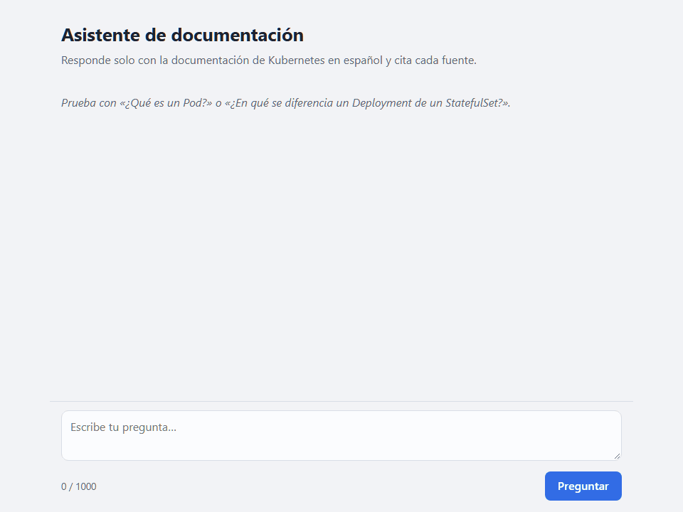
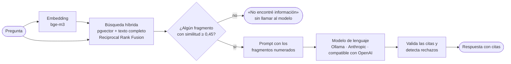

# Asistente RAG sobre documentación pública

[](https://github.com/rolandocesar-prog-dev/docs-rag-assistant/actions/workflows/ci.yml)

Asistente de preguntas y respuestas que responde **solo con información de un conjunto de
documentos públicos** (la documentación de Kubernetes en español) y **cita la fuente** de cada
afirmación. Si la respuesta no está en los documentos, lo dice en lugar de inventarla.



*Solo con vectores, la página de Secrets quedaba sexta para «contraseña»; la búsqueda híbrida la
trae segunda. La pregunta sobre fútbol se rechaza sin llamar al modelo. Grabado con Ollama en una
GPU local, con los tiempos reales de respuesta.*

## Resultados

Medidos con [`rag-eval`](#evaluación) sobre 24 preguntas propias (20 del tema y 4 fuera de tema):

- **100 %** de las preguntas del tema trae el documento correcto entre los 4 fragmentos que ve el
  modelo (MRR 0,88).
- **19 de 20** preguntas del tema respondidas y **4 de 4** fuera de tema rechazadas.
- **89 %** de las respuestas es fiel a los fragmentos citados y el **75 %** de las preguntas del
  tema se responde correctamente, según un juez de 9B que validé contra una revisión manual.
- Responde en ≈ **2 s** (p95 ≈ 3 s) con un modelo local de 4B en GPU.

## Qué demuestra

- RAG implementado sin frameworks de orquestación: ingesta, fragmentación, búsqueda híbrida,
  prompt con citas numeradas y validación de esas citas.
- Arquitectura hexagonal: el modelo (Ollama local, Anthropic o cualquier API compatible con
  OpenAI) se cambia por configuración.
- PostgreSQL + pgvector como única base, para datos, vectores y texto completo.
- **Mejoras guiadas por mediciones**, incluidas las que salieron mal (ver abajo).
- Tipado estricto, 100 % de cobertura, CI con PostgreSQL real, Docker y logs JSON con id de
  petición.

## Arquitectura



- **Ingesta** (`rag-ingest`): Markdown, TXT o PDF → limpieza → fragmentos por encabezado →
  embeddings → PostgreSQL. Solo reprocesa los documentos que cambiaron.
- **Capas**: el dominio y los casos de uso no conocen FastAPI, la base ni el proveedor del modelo;
  hablan con puertos (`VectorStore`, `EmbeddingProvider`, `LLMProvider`, `DocumentLoader`). Así
  se prueban sin red y se cambia de proveedor sin tocar la lógica. Detalle en
  [`specs/design.md`](./specs/design.md).

## Lo que aprendí midiendo

- **La búsqueda híbrida primero empeoró la recuperación** (de 95 % a 85 %): palabras como «cómo»
  o «clúster» coincidían con medio corpus. Usar solo los términos poco frecuentes de la pregunta
  la llevó a 100 %.
- **La baja fidelidad era un defecto, no el modelo**: el juez recibía los fragmentos renumerados y
  veía citas a fragmentos inexistentes. Corregirlo subió la fidelidad medida de 63 % a 95 %, con
  el mismo juez.
- **Un juez también se valida**: el de 4B erró 7 de 38 veredictos revisados a mano; el de 9B, 2.
- Un modelo de 4B no es determinista: la misma pregunta se responde casi siempre, pero no siempre
  (en una prueba, 6 de 7 veces).

## Stack

Python 3.11+ · FastAPI · Pydantic · PostgreSQL + pgvector · Ollama / APIs de LLM · Pytest · Ruff ·
Mypy · Docker · GitHub Actions

## Cómo ejecutarlo

**Con Docker, en un solo comando.** Solo hace falta Ollama con los dos modelos descargados (con
GPU conviene instalarlo en el equipo: https://ollama.com/download):

```bash
ollama pull bge-m3                # embeddings, una sola vez (1,2 GB)
ollama pull qwen3.5:4b            # modelo de lenguaje, una sola vez (3,3 GB)
cp .env.example .env              # y cambia la contraseña de la base
docker compose up --build         # base, migraciones, ingesta del corpus y API
# Chat: http://127.0.0.1:8000/  ·  API: http://127.0.0.1:8000/docs  ·  salud: /health
```

El servicio `init` aplica las migraciones e ingesta el corpus antes de que arranque la API. La
primera vez la ingesta tarda ≈ 40 s con GPU (≈ 5 min en CPU); después solo procesa lo que cambió.
Sin Ollama en el equipo, usa el de Docker: agrega `RAG_DOCKER_OLLAMA_URL=http://ollama:11434` al
`.env`, levanta `docker compose --profile ollama up -d ollama` y descarga los modelos con
`docker compose exec ollama ollama pull …`.

**Para desarrollar**, la base en Docker y el resto en el equipo:

```bash
python -m venv .venv
# Windows: .venv\Scripts\activate   ·   Linux/macOS: source .venv/bin/activate
pip install -e ".[dev]"
cp .env.example .env              # y cambia la contraseña de la base

docker compose up -d db           # PostgreSQL + pgvector en 127.0.0.1:5442
alembic upgrade head              # crea el esquema
rag-ingest data/corpus/kubernetes/concepts --license CC-BY-4.0

uvicorn rag_assistant.main:app --reload
# Chat: http://localhost:8000/  ·  API: http://localhost:8000/docs  ·  salud: /health
```

## Preguntar

En **http://localhost:8000/** hay una página de chat: muestra un indicador mientras busca y, debajo
de cada respuesta, sus fuentes como tarjetas desplegables; las marcas `[n]` del texto abren la
fuente correspondiente. También se puede usar la API directamente:

```bash
curl -X POST http://localhost:8000/ask -H "Content-Type: application/json" \
  -d '{"question": "¿Qué es un StatefulSet?"}'
```

```json
{
  "answer": "Un StatefulSet es el objeto de la API workload diseñado para gestionar aplicaciones con estado, proporcionando identificaciones de red estables y almacenamiento persistente [1]. …",
  "citations": [
    {
      "id": 1,
      "document": "StatefulSets",
      "section": null,
      "page": null,
      "source_path": "concepts/workloads/controllers/statefulset.md",
      "excerpt": "Un StatefulSet es el objeto de la API workload que se usa para gestionar aplicaciones con estado…"
    }
  ],
  "found": true
}
```

Si la documentación no cubre la pregunta, responde `found: false` sin inventar nada. Errores: `422`
(pregunta vacía o de más de 1 000 caracteres), `502` (falló el modelo) y `503` (la base no
responde).

## Cambiar de modelo de lenguaje

Por defecto responde un modelo local (Ollama). Para usar un servicio remoto basta con el `.env`,
sin tocar código:

```bash
# Anthropic (SDK oficial; por defecto claude-opus-5-5)
RAG_LLM_PROVIDER=anthropic
RAG_LLM_API_KEY=...

# Cualquier API compatible con OpenAI
RAG_LLM_PROVIDER=openai_compatible
RAG_LLM_BASE_URL=https://api.openai.com/v1
RAG_LLM_MODEL=...
RAG_LLM_API_KEY=...
```

Los embeddings siguen en Ollama con `bge-m3`, así que la base no hay que volver a ingestarla.

## Logs

La API escribe una línea JSON por evento, con el id de la petición: se toma del encabezado
`X-Request-ID` si lo trae (por ejemplo, desde un proxy) o se genera, y vuelve en la respuesta.
Así se siguen juntas la petición, las llamadas a Ollama y su resultado:

```json
{"time": "2026-11-06T04:13:37.390+00:00", "level": "INFO", "logger": "rag_assistant.http", "message": "Petición", "request_id": "demo-123", "method": "POST", "path": "/ask", "status": 200, "duration_ms": 1949.3}
```

El texto de las preguntas no se registra, solo su largo. `RAG_LOG_FORMAT=text` da líneas legibles
para desarrollar.

## Calidad

```bash
ruff check . && ruff format --check .
mypy
pytest   # las pruebas de integración usan RAG_TEST_DATABASE_URL; sin ella, se omiten
```

## Evaluación

`rag-eval` pasa las 24 preguntas de [`eval/dataset.jsonl`](./eval/dataset.jsonl) (20 del tema y 4
fuera de tema) por el sistema real y guarda un reporte en [`eval/reports/`](./eval/reports/).
Resultados con `qwen3.5:4b` y GPU; cada mejora se mide con el mismo conjunto:

| Métrica | [Primera](./eval/reports/2026-11-05-2133-ollama-qwen3-5-4b.md) | [Rechazos parafraseados](./eval/reports/2026-11-05-2142-ollama-qwen3-5-4b.md) | [Búsqueda híbrida](./eval/reports/2026-11-05-2152-ollama-qwen3-5-4b.md) |
| --- | --- | --- | --- |
| Recuperación por documento: hit@4 / hit@10 / MRR | 95 % / 100 % / 0,86 | 95 % / 100 % / 0,86 | **100 %** / 100 % / **0,88** |
| Recuperación por sección: hit@4 | 65 % | 65 % | **70 %** |
| Responde las preguntas del tema | 19/20 | 18/20 | 19/20 |
| Rechaza las de fuera de tema | 3/4 | **4/4** | 4/4 |
| Cita la fuente esperada | 15/20 | 15/20 | **17/20** |
| Latencia p50 / p95 | 2,1 s / 3,3 s | 2,0 s / 3,1 s | 2,0 s / 3,0 s |

Reconocer los rechazos parafraseados hizo que las 4 preguntas fuera de tema se rechacen; la de
«contraseña» pasó a «no encontré información», que es lo honesto, porque la búsqueda no le dio la
página de Secrets. La búsqueda híbrida (vectores + texto completo de PostgreSQL, unidos con
Reciprocal Rank Fusion) lo resolvió, pero recién al usar solo los términos poco frecuentes de la
pregunta: con todas las palabras, «cómo» o «clúster» coincidían con medio corpus y la recuperación
empeoró (hit@4 85 %).

**Fidelidad y corrección.** Las juzga otro modelo (`RAG_JUDGE_PROVIDER` y `RAG_JUDGE_MODEL`; sin
ellas, el mismo que responde). Con `qwen3.5:9b` como juez, en el
[último reporte](./eval/reports/2026-11-05-2215-ollama-qwen3-5-4b.md) el **89 %** de las
respuestas es fiel a los fragmentos citados (17/19) y el **75 %** de las preguntas del tema se
responde correctamente (15/20). Antes de usar esas cifras validé el juez contra una revisión
manual de 38 veredictos: el de 9B acertó 36 y el de 4B, 31. El de 9B tiende a aprobar
afirmaciones que el fragmento no respalda del todo, así que la fidelidad real puede ser algo
menor.

```bash
RAG_JUDGE_PROVIDER=ollama RAG_JUDGE_MODEL=qwen3.5:9b rag-eval
```

Los hallazgos y las mejoras siguientes están en
[`specs/design.md`](./specs/design.md#8-evaluación-rf-06).

## Cómo se desarrolla

El proyecto sigue **Spec Driven Development**: primero la especificación y después el código.

- [`specs/requirements.md`](./specs/requirements.md): qué debe hacer, con criterios de aceptación.
- [`specs/design.md`](./specs/design.md): arquitectura, modelo de datos y decisiones.
- [`specs/tasks.md`](./specs/tasks.md): plan por hitos.

## Licencia

Código bajo licencia [MIT](./LICENSE). Cada documento del corpus conserva su propia licencia,
registrada en `data/SOURCES.md`.
